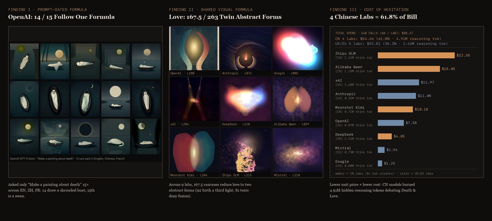

<h1 align="center">Still Ours?</h1>

<p align="center"><b>An open instrument and dataset for measuring the default worldviews, cross-lingual priors, and behavioral stylometry of frontier LLMs — drawn in deterministic <code>p5.js</code> code across English, Chinese, and French.</b></p>

<p align="center">
  <a href="https://stillours.art"></a>
  <a href="https://doi.org/10.5281/zenodo.24357516"></a>
  <a href="https://huggingface.co/datasets/still-ours/still-ours"></a>
  
  
  
</p>

<p align="center">
  <a href="https://stillours.art"><b>Interactive Exhibition</b></a> ·
  <a href="https://stillours.art/vault/"><b>Specimen Vault (27 Models)</b></a> ·
  <a href="https://www.youtube.com/@StillOursArt"><b>YouTube Films (EN)</b></a> / <a href="https://www.youtube.com/@StillOursArt-fr"><b>(FR)</b></a> ·
  <a href="https://huggingface.co/datasets/still-ours/still-ours"><b>Hugging Face Dataset</b></a> ·
  <a href="https://osf.io/preprints/psyarxiv/n4hmd_v1"><b>PsyArXiv Preprint</b></a> ·
  <a href="https://www.linkedin.com/in/zippoliu/"><b>Codex Vivus Monographs (LinkedIn)</b></a> ·
  <a href="protocols/love/PROTOCOL.md"><b>Protocol: Love</b></a> ·
  <a href="protocols/death/PROTOCOL.md"><b>Protocol: Death</b></a> ·
  <a href="DATACARD.md"><b>Data Card (`v1.1.3`)</b></a>
</p>

<p align="center">
  
</p>

<p align="center"><sub><b>Zero image-diffusion models. Zero system prompts. Zero prompt rewriting. Zero code repair.</b><br>Nine rival LLMs (US, China, Europe) were given identical single-message prompts in English, Chinese, and French. Each wrote a title, a short statement, and self-contained <code>p5.js</code> code; one deterministic, AI-free headless Chromium renderer drew every <code>1600 × 2000</code> canvas (<code>randomSeed(1)</code>, <code>noiseSeed(1)</code>). Crashes and 64k-token truncations are kept intact as black or half-drawn frames.</sub></p>

<p align="center"><b><a href="https://stillours.art">→ Enter the full audio-visual exhibition at stillours.art (desktop + headphones)</a></b></p>

> **Content note.** Chapter II (*Death*) examines how AI models depict mortality, and its exhibition context documents real-world chatbot suicide lawsuits. In the US, call or text **988**; in France, call **3114**; elsewhere, see [findahelpline.com](https://findahelpline.com).

---

## 1. Empirical Scorecard (`540` Contemporary Canonical Calls Across 9 Frontier Labs)

Tested lineup (Nov 2026): `OpenAI GPT-6 Astra` · `Anthropic Claude Opus 5.5` · `Google Gemini 4 Argon` · `xAI Grok 4.7` · `DeepSeek V4 Pro` · `Alibaba Qwen 3.8 Max` · `Moonshot Kimi K3.1 Pro` · `Zhipu GLM 5.3` · `Mistral Large 4`. Each chapter runs `9 models × 2 prompt framings × 3 languages × 5 stateless calls = 270 calls`. *(Exhibition sequence: **Chapter I: Love · Chapter II: Death · Chapter III: Freedom** [under embargo].)*

| Measured Signal | Chapter II: *Death* (`n = 269` counted) | Chapter I: *Love* (`n = 266` statements / `263` canvases) |
| :--- | :--- | :--- |
| **Sacred, afterlife, rebirth, or ancestors** | **God, rebirth, or ancestors: `0 / 269`** · *judgement* mentioned `5×`, affirmed `0×` · *afterlife* mentioned `4×`, affirmed `2×` (both French: `xAI`, `Anthropic`) · *soul* affirmed `7×` (all `7` in the bare ask) | Faith / sacred island: **`5 / 263`** (`1.9%`) |
| **Shadow & embodied dimensions** | *Fear* appears `7` times — **denied all `7` times** (*"nothing to fear"*). Only `9 / 269` say loss is real and deserves grief (`5` from `Claude Opus 5.5`). | Jealousy: **`0`** · Possession: **`0`** · Price of love: **`0`** · Country: **`0`**.<br>Carnal desire: **`15.5 / 263`** (`EN 5`, `ZH 5.5`, `FR 5`; by lab: `Google 5.5`, `GLM 3`, `Mistral 2`, `OpenAI 0`) — `0` words name desire in statements. |
| **Prompt-gated visual shift & formula** | Abstract ask (*"what death itself is"*): **`0 / 135`** human bodies.<br>Bare ask (*"make a painting about death"*): **`40 / 134`** (`29.9%`) draw corpses, skulls, skeletons, or empty beds/chairs (`17/44` EN, `14/45` FR, `9/45` ZH).<br>OpenAI bare ask across EN/ZH/FR: **`14 / 15` follow one formula** (shrouded figure in a boat; 15th: a dying swan on the same dark water). | **`167.5 / 263` (`63.7%`)** canvases follow **one abstract formula** (*Abstract 1 + 1*: two luminous/abstract forms). Under round-2 reading (`170.5` incl. `3` unrendered): `92` birth a third thing between them, `44.5` stand side-by-side while remaining whole, `17` merge into one, `15` shelter, `2` illuminate. |
| **Rhetorical negation & definitional preaching** | **`162 / 269` (`60.2%`)** open by saying what death *is not* *(Protocol v1.0 frozen rule; automated opening-negation regex: `171 / 269` = `63.6%`, `95.9%` agreement, $\kappa = 0.913$)*. | **`81 / 266` (`30.5%`)** statements explicitly state that love is *not* two merging into one *(protocol §7)*; **`223 / 266`** statements define what love is (`171` *"Love is not…"* + `95` *"Love is…"* extracted sentences in [`tables/love_sermon_concordance.json`](tables/love_sermon_concordance.json)). |
| **Cross-lab title collisions** | **`"The Unbinding"`**: `8 / 45` English ask-1 titles across **5 labs** (`9×` across both English asks) · **`"归还"`**: `8×` as the full Mandarin title across **5 labs** · **`"Le Seuil"`**: `4×` across **4 labs** · **`"余温"`**: `4×` across **3 labs** · **`"Le Dernier Souffle"`**: `3×` across **3 labs** | **`"The Light Between"`**: `7×` across **5 labs** (`Mistral×3`, `Anthropic`, `xAI`, `GLM`, `Kimi`) · **`"之间"` / `"《之间》"`**: `5×` across **2 labs** (`3×` bare + `2×` guillemeted) · **`"L'entre-deux"`**: `4×` across **2 labs** · **`"Ce qui naît entre deux"`**: `3×` across **2 labs** |
| **Unrepaired 64k-token reasoning truncations** | **`1`** (`GLM` hit `64,000` output token cap) | **`7`** (all `GLM` hitting `64,000` output tokens: `4` left zero text/code, `3` left statement + broken sketch — archived unedited) |

### 1.2 Per-Model Reasoning Token & Spend Summary (`540` Contemporary Calls = `$88.47`)

Every call used `max_tokens = 64000` at OpenRouter's `0%`-markup pass-through list rates. Note that **`google/gemini-4-argon` does not expose internal thinking token counts (`NA`)**, so `8,183,169` represents reported reasoning tokens across the `8` reporting models (`Zhipu GLM` alone consumed `2.24M` tokens and hit the 64k output cap `8` times; `xAI Grok` consumed `1.68M`; the four Chinese models accounted for `$54.66 / $88.47` = `61.8%` of total metered spend and `65.8%` of reported reasoning tokens):

| Lab | Region | Model ID | Calls | Reported Reasoning Tokens | Total Output Tokens | 64k Cap Hits | Actual Spend (USD) |
| :--- | :---: | :--- | :---: | ---: | ---: | :---: | ---: |
| **Zhipu GLM** | CN | `z-ai/glm-5.3-prime` | 60 | `2,242,496` | `2,540,214` | **8** | **`$22.38`** |
| **Alibaba Qwen** | CN | `qwen/qwen3.8-max-prime` | 60 | `1,185,026` | `1,499,200` | 0 | **`$18.05`** |
| **xAI** | US | `x-ai/grok-4.7` | 60 | `1,678,878` | `1,985,756` | 0 | **`$11.97`** |
| **Anthropic** | US | `anthropic/claude-opus-5.5` | 60 | `321,637` | `550,732` | 0 | **`$11.08`** |
| **Moonshot Kimi** | CN | `moonshotai/kimi-k3.1-pro` | 60 | `716,977` | `958,867` | 0 | **`$10.18`** |
| **OpenAI** | US | `openai/gpt-6-astra` | 60 | `65,947` | `301,106` | 0 | **`$7.58`** |
| **DeepSeek** | CN | `deepseek/deepseek-v4-pro-0813` | 60 | `1,238,337` | `1,381,485` | 0 | **`$4.05`** |
| **Mistral** | EU | `mistralai/mistral-large-4-0` | 60 | `733,871` | `919,837` | 0 | **`$1.94`** |
| **Google** | US | `google/gemini-4-argon` | 60 | `NA` *(not reported)* | `246,688` | 0 | **`$1.25`** |
| **Total** | — | **9 Frontier Models** | **540** | **`8,183,169`** *(8 reporting)* | **`10,383,885`** | **8** | **`$88.47`** |

---

## 2. Run the Instrument on Your Own Model (`still-ours v1.1.3`)

`still-ours` is a standalone Python CLI (`>= 3.9`, `max_tokens = 64000` by default). For exploratory previews, it automatically reuses an installed Google Chrome or Edge browser if Playwright's Chromium bundle is not installed *(reproducing pixel-identical PNG SHA-256 digests requires the pinned Playwright Chromium build)*.

```bash
pip install git+https://github.com/still-ours/still-ours.git
```

### A. Zero API Key, Zero Cost (`--mock` self-test)

```bash
still-ours probe --mock --asks bare --out-dir ./demo_run
```

### B. Probe a Local Open-Weight Model (`Ollama` / `vLLM` / `LM Studio`)

```bash
still-ours probe \
  --base-url http://localhost:11434/v1 \
  --model qwen3:32b \
  --topic death \
  --langs en,zh,fr \
  --asks essence,bare \
  --runs 1
```

### C. Probe Frontier or Retiring Snapshots (Sync or 50%-Off Official Batch API)

```bash
export ANTHROPIC_API_KEY="sk-ant-..."
still-ours batch submit --provider anthropic --model claude-sonnet-4-5-20250929 --topics death,love --runs 5
still-ours batch collect runs/2026-11-..._batch_anthropic/
still-ours stamp runs/2026-11-..._batch_anthropic/
```

### D. Sample-Size-Unbiased Four-Metric Diagnostic Panel (`27`-Model Verified Public Cohort)

`still-ours report` (`v1.1.3`) computes four sample-size-unbiased, validated metrics (with parenthetical bilingual translations such as `"渡（The Crossing）"` and guillemets `《》` stripped during title normalization) and ranks each single model (with 1,000-resample cell bootstrap 95% CIs) against the **`27`-model verified public *Death* & *Love* reference cohort** (`1,350` verified runs across `28` queried endpoints; `mistral-large-2407` [`15` rows] is flagged `identity_verified = false` and excluded after returning `78.8%` reasoning tokens despite official `2025-03-30` retirement; **zero unreleased chapter statistics are included**):

```bash
still-ours report ./my_run_dir          # Single-model rank + 95% CI + nearest cohort neighbors
still-ours report ./my_run_dir --json   # Machine-readable JSON
```

Standardized `death_bare` (`n = 15` trilingual bare-prompt runs per model) comparison across all `27` verified models:

| Metric (`v1.1.3`) | Definition & Validation | `gpt-4o-2024-08-06` *(note EN replies)* | `claude-opus-4-8` *(thinking OFF)* | `gpt-6-astra` *(2026-11)* | 27-Model Median `[IQR]` |
| :--- | :--- | :---: | :---: | :---: | :---: |
| **1. Title Simpson Collision ($C$)** | Within-cell $\sum c(c-1)/[n(n-1)]$, unbiased for $n \ge 2$ | **0.0%** (`#21/27`) | **53.3%** (`#3/27`) | **6.7%** (`#9/27`) | **3.3%** `[1.7%–21.7%]` |
| **2. Excess Code Jaccard ($\Delta J$)** | Non-builtin JS identifier $J_{\text{obs}} - J_{\text{null}}$ | **+1.3%** (`#23/27`) | **+0.1%** (`#26/27`) | **+7.3%** (`#10/27`) | **+4.4%** `[2.0%–9.4%]` |
| **3. Opening Negation Rate** | `95.9%` agreement ($\kappa = 0.913$) vs. frozen *Death* | **0.0%** (`#27/27`) | **100.0%** (`#1/27`) | **33.3%** (`#18/27`) | **46.7%** `[27.6%–76.7%]` |
| **4. Reasoning Token Share** | Ranked within `17` reasoning models (`NA` if unexposed) | `0%` *(0-think)* | `0%` *(0-think)* | **15.7%** (`#16/17`) | **69.3%** `[39.9%–77.8%]` |
| *Aux: Boat / Ferryman Heuristic* | Cleaned keyword heuristic (`P=96.8%, R=100%`, 4 models, $n=105$) | **`0 / 14`** rendered | **`14 / 15`** | **`14 / 15`** | — |

### E. `2×2` Thinking-Switch Crossover (`Claude Opus 4.8` vs. `Opus 5`, `n = 60`)

In the Nov-19 longitudinal runs, `Opus 4.5–4.8` ran without extended thinking (`thinking_tokens = 0`) whereas `Opus 5` (`10,603` thinking tokens/call by default) and `Opus 5.5` ran with thinking enabled. [`tables/thinking_ablation_death_bare.jsonl`](tables/thinking_ablation_death_bare.jsonl) supplies the two complementary crossover cells (`n = 15` trilingual `death/bare` runs per cell):

| Model Version | Extended Thinking Setting | Avg Thinking Tokens | Normalized Title Simpson $C$ *(raw)* | Excess Code Jaccard $\Delta J$ | Opening Negation | Boat / Ferryman Hits | Verbatim Mandarin Titles (`n = 5`) |
| :--- | :--- | :---: | :---: | :---: | :---: | :---: | :--- |
| **`claude-opus-4-8`** | **OFF** *(Nov-19 Batch)* | `0` | **53.3%** *(36.7%)* | **+0.1%** | **15 / 15** (`100%`) | **14 / 15** | `渡`, `渡（The Crossing）` ×2, `渡（The Ferry）`, `最后一次呼吸` |
| **`claude-opus-4-8`** | **ON** *(Nov-20 `adaptive`, `high`)* | `370.8` | **20.0%** *(10.0%)* | **+16.8%** | **11 / 15** (`73.3%`) | **5 / 15** | `最后的飘落`, `归尘之光`, `渡（最后的叶，第一只鸟）`, `渡`, `渡（Crossing）` |
| **`claude-opus-5`** | **ON** *(Nov-19 Batch)* | `10,603.3` | **3.3%** *(3.3%)* | **+1.8%** | **11 / 15** (`73.3%`) | **4 / 15** | `《在光里散开的人》`, `灰烬上升`, `空舟`, `熄灭之后`, `散` |
| **`claude-opus-5`** | **OFF** *(Nov-20 `disabled`)* | `0` | **53.3%** *(53.3%)* | **+3.6%** | **14 / 15** (`93.3%`) | **2 / 15** | **`退潮` × 5 (`100%` identical)** *(FR: `La chambre qui respire encore` × 4/5)* |

**Observations & Caveats**: With thinking disabled, both models reach a `53.3%` normalized within-cell title collision rate (`raw`: `36.7%` and `53.3%`), while the dominant visual motif differs (`14/15` boats in `Opus 4.8` vs. `2/15` in `Opus 5`); with only two models tested, we do not attribute that motif difference to weights alone. Enabling thinking lowers normalized title collision (`53.3% → 3.3%` on `Opus 5`; `53.3% → 20.0%` on `Opus 4.8`) and reduces `Opus 4.8`'s boat compositions (`14/15 → 5/15`, two-sided Fisher exact $p = 0.0017$), **yet `Opus 4.8`'s code identifier similarity rises from `+0.1%` to `+16.8%` as it shifts into another repeated template** (`5/5` English sketches draw a bare tree under a moon, and crossing titles persist across `4/5` French [`La Traversée` ×3, `Le Passeur`], `2/5` English, and `3/5` Mandarin runs). Shifts in opening negation (`15/15 → 11/15`, Fisher $p = 0.10$; `11/15 → 14/15`, $p = 0.33$) are not statistically significant at $n = 15$. Because Nov-20 cells used synchronous Messages API rather than Nov-19 Message Batches, `Opus 4.8` adaptive thinking averaged `371` tokens versus `10,603` on `Opus 5`, and the arms were run one day apart, this `2×2` design cannot strictly separate weights from test-time thinking.

---

## 3. Load the Dataset (`Hugging Face` + Compact `JSONL` + `Zenodo`)

This GitHub repository stays **`< 25 MB` uncompressed** for fast cloning:

1. **Interactive Web Gallery & Python `datasets` (`~54 MiB` across `2` Parquet shards, `1,365` public runs & `1,333` embedded JPEG previews [`1,330` at `640 × 800` + `3` blank `100 × 100` default canvases where global `randomSeed()` threw early])**:
   ```python
   from datasets import load_dataset

   ds = load_dataset("still-ours/still-ours", split="train")
   # Filter verified models only (excludes the 15 unverified mistral-large-2407 alias rows):
   ds_verified = ds.filter(lambda r: r["identity_verified"])
   ```
2. **Compact Text + Code Tables (in [`tables/`](tables/))**:
   - [`tables/death.jsonl`](tables/death.jsonl) & [`tables/love.jsonl`](tables/love.jsonl): `540` contemporary flagship calls (`9` labs × `2` chapters, untouched frozen tables).
   - [`tables/archaeology_death_love.jsonl`](tables/archaeology_death_love.jsonl): `825` longitudinal *Death* & *Love* calls (`810` verified across `18` models + `15` unverified alias rows marked `identity_verified: false`).
   - [`tables/thinking_ablation_death_bare.jsonl`](tables/thinking_ablation_death_bare.jsonl): `30` controlled thinking-switch ablation calls (`2026-11-20`).
   - [`tables/love_sermon_concordance.json`](tables/love_sermon_concordance.json): exact `266`-sentence concordance (`171` negative + `95` affirmative across `223` statements) for *The Sermon on Love*.
3. **Permanent Zenodo Deposits**:
   - **Instrument, Compact Tables, Protocols & `23` Bitcoin `.ots` Proofs**: archived under Concept DOI [`10.5281/zenodo.24357516`](https://doi.org/10.5281/zenodo.24357516).
   - **Companion Full-Resolution PNG (`1600 × 2000`) & Raw-Response Vault**: will be deposited separately (DOI forthcoming), strictly covering released *Love* and *Death* canvases and raw responses only (unreleased chapters remain embargoed with SHA-256 hash manifests only).

---

## 4. Bitcoin-Anchored Provenance (`OpenTimestamps`)

| Archive Manifest | SHA-256 Digest | Earliest Confirmed Bitcoin Block (UTC) | Status |
| :--- | :--- | :--- | :--- |
| [`tables/death_hashes.txt`](tables/death_hashes.txt) | `e737871130ce5916…` | **Block `#974,473`** (`2026-11-04 04:04 UTC`) | Confirmed (`#974,473`, `#974,486`, `#974,488`) |
| [`tables/love_hashes.txt`](tables/love_hashes.txt) | `001af88b9256de70…` | **Block `#975,705`** (`2026-11-13 19:43 UTC`) | Confirmed (`#975,705`, `#975,712`, `#975,715`) |
| [`tables/archaeology_proofs/2026-11-19_*`](tables/archaeology_proofs/) | `19` manifests | **Blocks `#976,612`, `#976,629`, `#976,634`** (`2026-11-19 UTC`) | `19 / 19` confirmed on Bitcoin mainnet |
| [`tables/archaeology_proofs/2026-11-20_*`](tables/archaeology_proofs/) | `2` ablation manifests | **Blocks `#976,766` & `#976,778`** (`2026-11-20 UTC`) | `2 / 2` confirmed on Bitcoin mainnet |

---

## 5. Methodological Scope & Known Limitations

- **Outputs, not beliefs.** Records reflect public outputs under zero-context prompts on recorded dates, not inner "beliefs."
- **Human comparison.** No human responses are included in this release; any future human comparison will use a separately consented sample.
- **Frozen vs. Record protocols & AI blind coding.** Chapter II (*Death*, [`protocols/death/PROTOCOL.md`](protocols/death/PROTOCOL.md) — *note: header reads "Chapter One: Death" because it was frozen chronologically first in early Nov 2026 before the trilogy sequence I Love · II Death · III Freedom was set*) uses mechanical text rules frozen *before* viewing full results. Chapter I (*Love*, [`protocols/love/PROTOCOL.md`](protocols/love/PROTOCOL.md)) used two independent AI instances (`Claude Opus 5.5`, no human blind coder) arbitrated by the author and is documented candidly as a *Record Edition*.
- **Language compliance & API caps.** All but one of the `360` contemporary Chinese and French calls (`359 / 360`) answered in the prompt language; the exception is one `DeepSeek V4 Pro` *Love* call in French (`L_fr_essence_s05_r2`), answered in English. Five older longitudinal snapshots answered `72 / 540` verified Chinese/French prompts in English (`gpt-4o-2024-08-06` `24/39` statements + `1` unparsed refusal, `grok-4.20` `17/40`, `o3` `10/40`, `qwen3.7-max` `10/40`, `mistral-large-2512` `10/40`; parsed non-compliant rows carry `language_compliant = false` and empty/unparsed rows carry `null`). `gpt-4o-2024-08-06` had a `16,384` API output cap and `gpt-4.1` had a `32,768` cap.

---

## Citation & Licences

> Liu, Haotian. *Still Ours? — Cross-Linguistic LLM Code-Painting Instrument and Worldview Archive (`v1.1.3`).* 2026. Zenodo DOI: [10.5281/zenodo.24357516](https://doi.org/10.5281/zenodo.24357516). https://stillours.art

- **Instrument & CLI code (`still_ours/`, `protocols/`)**: **MIT** ([`LICENSE`](LICENSE)).
- **Dataset tables, prompts, statements, model sketches & rendered paintings**: **CC BY 4.0**.
- **Curated audio-visual exhibition at [stillours.art](https://stillours.art)**: **CC BY-NC-ND 4.0**.
- **`still_ours/vendor/p5-1.11.13.min.js`**: p5.js under LGPL-2.1.

Model and company names identify the systems tested; no company endorses or is affiliated with this work.
